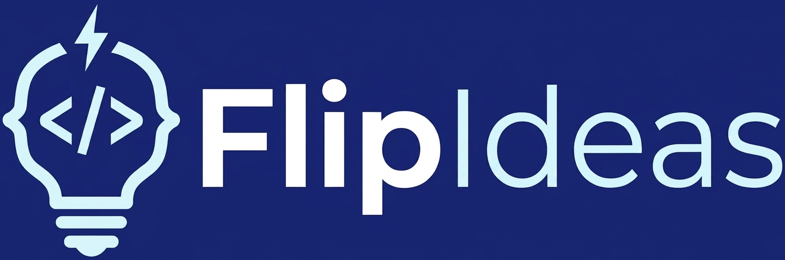
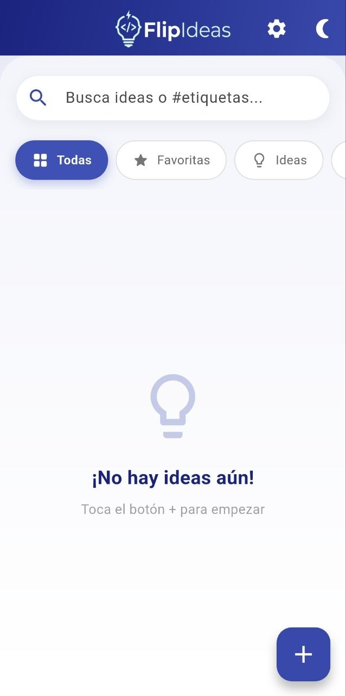
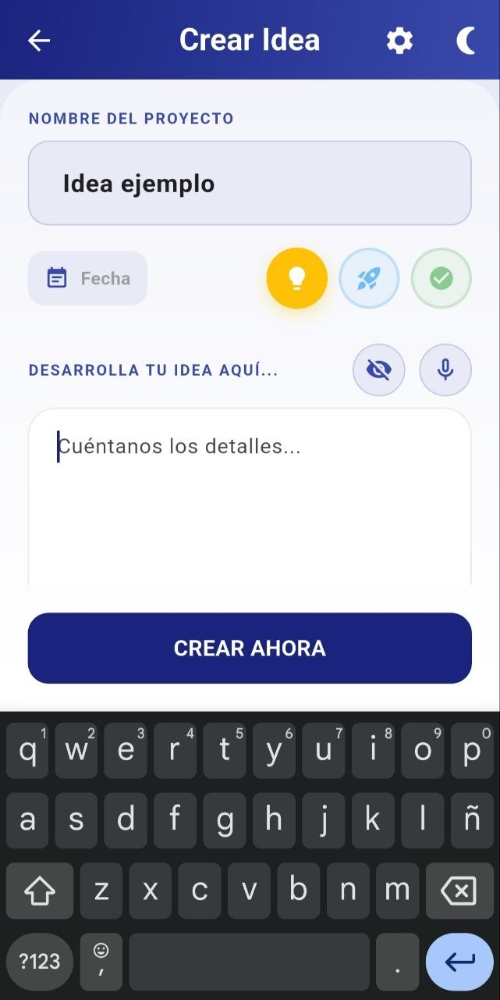
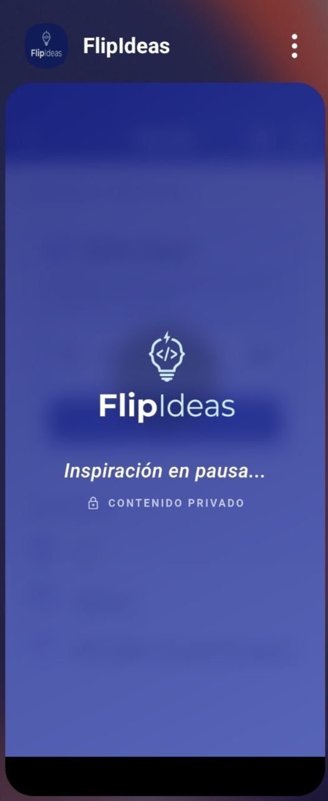
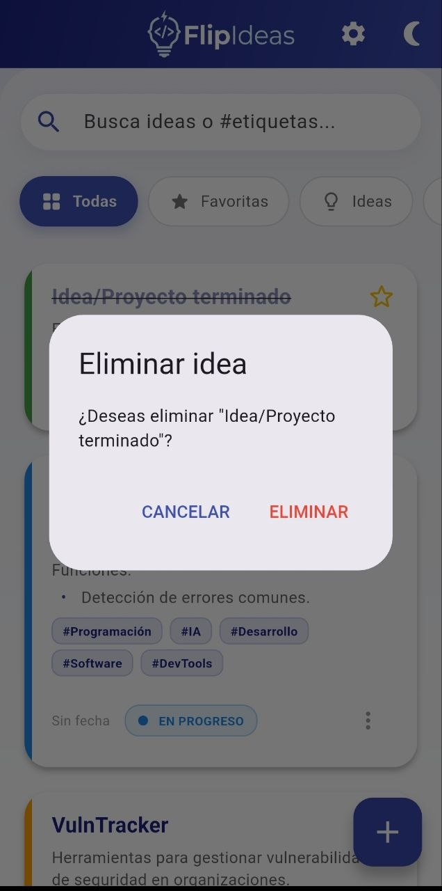
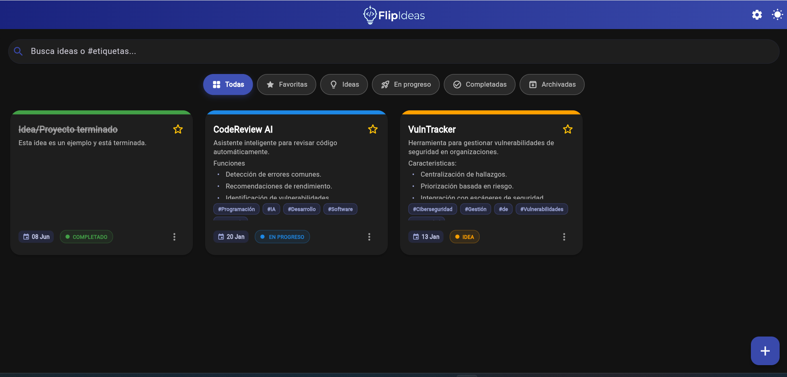
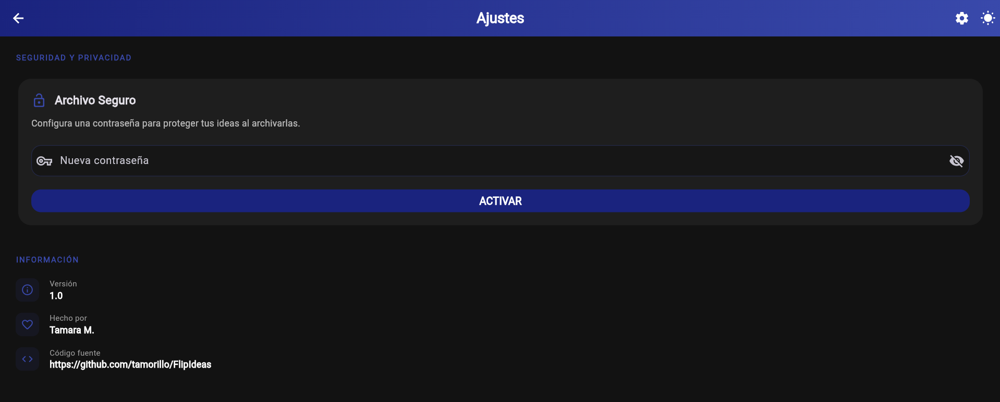

# 💡 FlipIdeas

**FlipIdeas** es una aplicación moderna y minimalista diseñada para capturar, organizar y proteger tus ideas más brillantes antes de que se escapen. Construida con **Flutter**, ofrece una experiencia fluida y segura para mentes creativas.

<p align="center">
  
  <br><br>
  
  
  
</p>

## ✨ Características Principales

- 📝 **Captura Rápida:** Guarda tus proyectos con título, etiquetas y descripción detallada compatible con **Markdown** (listas, negritas, enlaces, etc.).
- 🎙️ **Dictado por Voz:** ¿Vas con prisas? Usa el reconocimiento de voz para convertir tus pensamientos en texto al instante.
- 📸 **Inspiración Visual:** Adjunta imágenes que sirvan de referencia o inspiración para tus ideas.
- 🔒 **Privacidad Total:** 
    - **Capa de Privacidad Inteligente:** Cuando sales de la app o entras en la multitarea, tus ideas se ocultan tras un elegante desenfoque y frases motivadoras.
    - **Archivo Seguro:** Protege tus ideas archivadas con una contraseña personalizada.
- 🌓 **Modo Oscuro/Claro:** Elige el tema que mejor se adapte a tu momento de inspiración.
- ⭐ **Favoritos y Estados:** Marca tus mejores ideas y gestiona su progreso (Idea, En Progreso, Completada).
- 🏷️ **Búsqueda por Etiquetas:** Organiza todo con hashtags (ej: #Trabajo, #Personal) y encuéntralo en segundos.
- 📲 **Comparte:** Envía tus ideas a otras aplicaciones fácilmente.

## 🔒 Privacidad y Seguridad Técnica

FlipIdeas ha sido diseñada bajo la filosofía de **Privacidad por Diseño**:
- **Almacenamiento Local:** Tus ideas nunca viajan a ningún servidor. Se guardan localmente en el dispositivo mediante `SharedPreferences`.
- **Cero Telemetría:** No rastreamos tu comportamiento ni recolectamos datos de uso.
- **Seguridad en Multitarea:** La app utiliza el ciclo de vida del sistema para inyectar una máscara visual antes de que el sistema operativo tome la captura de pantalla para el selector de aplicaciones.

## 📸 Capturas de Pantalla

### 📱 Versión Android
| Inicio | Nueva Idea | Privacidad | Borrado |
| :---: | :---: | :---: | :---: |
|  |  |  |  |

### 🌐 Versión Web
**Vista General de Ideas**
<a href="assets/readme/homeWeb_ideas.png">
  
</a>

<br>

**Panel de Ajustes y Seguridad**
<a href="assets/readme/captura_ajustes_web.png">
  
</a>

## 📁 Estructura del Proyecto

La arquitectura del proyecto está organizada siguiendo las mejores prácticas de Flutter, separando la lógica de negocio de la interfaz de usuario y gestionando los recursos nativos de forma eficiente:

```text
FlipIdeas/
├── android/            # Configuración nativa para Android (Permisos, Vibración, Splash)
├── assets/             # Recursos estáticos: logos, imágenes de ayuda y placeholders
├── ios/                # Configuración nativa para iOS (Capa de privacidad nativa, permisos)
├── lib/                # 🧠 Núcleo de la aplicación (Dart)
│   ├── models/         # Definición de objetos de datos (Clase Idea)
│   ├── pages/          # Pantallas de la aplicación (UI completa)
│   ├── providers/      # Lógica de negocio y gestión de estados (Persistence & State)
│   ├── routes/         # Sistema de navegación centralizado (GoRouter)
│   ├── utils/          # Funciones de apoyo, seguridad y constantes
│   ├── widgets/        # Componentes visuales pequeños y reutilizables
│   └── main.dart       # Punto de entrada principal
├── test/               # Pruebas de widgets y lógica para asegurar la estabilidad
└── pubspec.yaml        # 📦 El corazón del proyecto: dependencias y recursos
```

## 🚀 Tecnologías Utilizadas

- **Lenguaje:** Dart
- **Framework:** Flutter (3.10+)
- **Gestión de Estado:** Provider
- **Navegación:** GoRouter
- **Persistencia:** SharedPreferences
- **Paquetes Clave:**
    - `speech_to_text` (Reconocimiento de voz)
    - `vibration` (Feedback háptico)
    - `share_plus` (Compartir contenido)
    - `flutter_markdown` (Visualización de texto enriquecido)

## 📋 Requisitos y Preparación

Antes de empezar, asegúrate de tener instalado:
- **Flutter SDK:** `>= 3.10.0`
- **Dart SDK:** `>= 3.0.0`
- Un emulador o dispositivo físico (Android o Navegador Web).

## 🚀 Instalación

Si quieres probar el proyecto localmente:

1. Clona el repositorio:
   ```bash
   git clone https://github.com/tamorillo/FlipIdeas.git
   ```
2. Entra en la carpeta:
   ```bash
   cd FlipIdeas
   ```
3. Instala las dependencias:
   ```bash
   flutter pub get
   ```
4. Ejecuta la aplicación:
   ```bash
   flutter run
   ```

## 🗺️ Próximos Pasos (Roadmap)

- [ ] ☁️ **Sincronización Opcional:** Backup cifrado en la nube (Firebase/Supabase).
- [ ] 📄 **Exportación:** Guardar ideas como archivos PDF o imágenes.
- [ ] 🎨 **Temas Personalizados:** Selección de colores de acento dinámicos.
- [ ] 📅 **Recordatorios:** Notificaciones push para fechas límite de proyectos.

## 🤝 Contribuciones

¡Cualquier aporte y sugerencia es más que bienvenida! Si tienes ideas para mejorar **FlipIdeas**, encuentras algún error o quieres proponer una nueva funcionalidad, no dudes en abrir un *Issue* o enviar un *Pull Request*. ¡Hagamos esta app más brillante juntos!

## 📝 Licencia

Este proyecto está bajo la Licencia **MIT**. Consulta el archivo [LICENSE](LICENSE) para más detalles.

---

Hecho con ❤️ por [Tamara M.](https://github.com/tamorillo)
